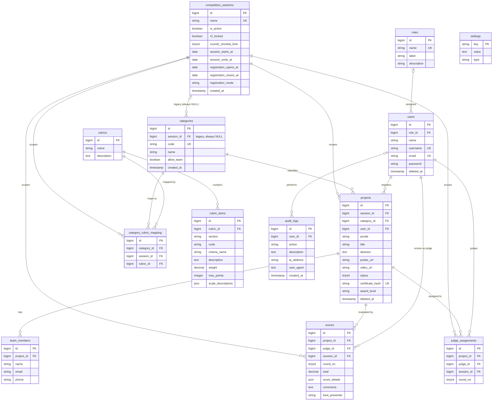

# Database Architecture Reference: INOTEK

This document outlines the database design, Entity Relationship Diagram (ERD), schema definitions, and constraints for the INOTEK system.

_Last reviewed: 12 November 2026 (against `database/migrations` up to `2026_11_02_000001` and `app/Models`)._

> [!NOTE]
> Competition sessions live in `competition_sessions`. The `sessions` table (fresh installs) and `laravel_sessions` table (repaired by `2026_10_22_000002`) belong to Laravel's HTTP session driver and are unrelated to competition data.

---

## 1. Entity Relationship Diagram (ERD)

---

## 2. Table Specifications

### 2.1 Table: `competition_sessions`
Defines competition semesters or sessions. Projects, approvals, judge assignments,
rubric mappings and scores are scoped to a session. The active session is the default
context for operational dashboards; session and registration dates control the
registration window. Administrators see concise dates rather than raw UTC timestamps.
| Column | Type | Nullable | Constraints & Description |
| :--- | :--- | :--- | :--- |
| `id` | BigInt | No | Primary Key, Auto-increment. |
| `name` | Varchar(255) | No | Unique. Session display name (e.g. "Sesi 1/2026"). |
| `is_active` | Boolean | No | Default: `false`. Scopes active operations; only one session is kept active. |
| `r2_locked` | Boolean | No | Default: `false`. Locks Round 2 scores and publishes award levels to non-admins. |
| `round2_shortlist_limit` | UnsignedTinyInt | No | Default: `3`. Number of Round 1 projects shortlisted for Round 2. |
| `session_starts_at` / `session_ends_at` | Date | Yes | Overall session period. Registration is closed before the start date and after the end date in **every** mode. |
| `registration_mode` | Varchar(16) | No | Default: `scheduled`. `open`, `closed`, or `scheduled`. Replaces the short-lived `registration_open` boolean (added and then dropped on 2026-10-23; its values were migrated to `open`/`closed`). |
| `registration_opens_at` / `registration_closes_at` | Date | Yes | Registration period used when `registration_mode` is `scheduled`. If either date is missing, a scheduled session is treated as closed (`CompetitionSession::isRegistrationOpen()`). |
| `created_at` / `updated_at` | Timestamp | Yes | Standard record timestamps. |

> [!NOTE]
> There is no Round 1 lock column. Round 1 is locked automatically once any Round 2 `judge_assignments` row exists for the session (`ScoreCalculator::isRoundOneLocked()`).

### 2.2 Table: `categories`
Global category catalog reused by every competition session. A category is created
once and its same code/name is available in future sessions. Projects still carry
their own `session_id`, so sharing categories does not combine project records.
| Column | Type | Nullable | Constraints & Description |
| :--- | :--- | :--- | :--- |
| `id` | BigInt | No | Primary Key, Auto-increment. |
| `session_id` | BigInt | Yes | Legacy Foreign Key referencing `competition_sessions.id` (null-on-delete). Always `NULL` since categories became global (`2026_10_23_000002`). |
| `code` | Varchar(255) | No | Unique across all categories. e.g. "C1", "C2" |
| `name` | Varchar(255) | No | e.g. "Emerging Technology" |
| `allow_team` | Boolean | No | Default: `false`. True if team registrations are allowed (group projects). |
| `created_at` / `updated_at` | Timestamp | Yes | Standard record timestamps. |

> [!NOTE]
> A category that has projects cannot be deleted (blocked in `Admin\CategoryController`).

### 2.3 Table: `roles`
System authorization access keys.
| Column | Type | Nullable | Constraints & Description |
| :--- | :--- | :--- | :--- |
| `id` | BigInt | No | Primary Key. |
| `name` | Varchar(255) | No | Unique technical identifier key (e.g. `admin`, `lecturer`, `judge`, `user`). |
| `label` | Varchar(255) | No | Display name (e.g. `Lecturer`). Nullable on adopted legacy tables, backfilled from `name`. |
| `description` | Varchar(255) | Yes | Role capabilities overview. |
| `guard_name` | Varchar(255) | — | Legacy only: present when an older Spatie `roles` table was adopted. Not used by the application. |
| `created_at` / `updated_at` | Timestamp | Yes | Standard record timestamps. |

### 2.4 Table: `users`
Accounts list.
| Column | Type | Nullable | Constraints & Description |
| :--- | :--- | :--- | :--- |
| `id` | BigInt | No | Primary Key, Auto-increment. |
| `role_id` | BigInt | Yes | Foreign Key referencing `roles.id`, null-on-delete. New accounts receive the `user` role. |
| `name` | Varchar(255) | No | Full name. Nullable on legacy installs where the column was added later (backfilled from `username`). |
| `username` | Varchar(255) | No | Unique username identifier. |
| `email` | Varchar(255) | No | Unique email address. |
| `email_verified_at` | Timestamp | Yes | Email verification time. |
| `password` | Varchar(255) | No | Hashed password string. |
| `two_factor_secret` | Text | Yes | Encrypted TOTP secret (Fortify). |
| `two_factor_recovery_codes` | Text | Yes | Encrypted 2FA recovery codes. |
| `two_factor_confirmed_at` | Timestamp | Yes | When 2FA was confirmed. |
| `remember_token` | Varchar(100) | Yes | Session persistent token. |
| `created_at` / `updated_at` | Timestamp | Yes | Present on fresh installs only. Legacy user records do not necessarily have these columns; the User model does not write timestamps (`$timestamps = false`). |
| `deleted_at` | Timestamp | Yes | Soft delete support. |

### 2.5 Table: `projects`
Project details submitted by participants.
| Column | Type | Nullable | Constraints & Description |
| :--- | :--- | :--- | :--- |
| `id` | BigInt | No | Primary Key, Auto-increment. |
| `session_id` | BigInt | No | Foreign Key referencing `competition_sessions.id`. Cascade-on-delete. |
| `category_id` | BigInt | No | Foreign Key referencing `categories.id`. Cascade-on-delete. |
| `user_id` | BigInt | No | Foreign Key referencing `users.id`. Cascade-on-delete. Column type matches the actual `users.id` type on legacy installs. |
| `pcode` | Varchar(255) | Yes | Unique project code within the session (auto-generated or overridden). |
| `title` | Varchar(255) | No | Project title. |
| `abstract` | Text | No | Project abstract details. |
| `poster_url` | Varchar(255) | Yes | File upload path to the project poster. |
| `video_url` | Varchar(255) | Yes | Path to the demonstration video. |
| `institution_type`| Varchar(255) | No | Institution origin: `utem` or `ipt`. |
| `status` | TinyInt | No | Default: `1`. Values (`Project` constants): `1` NEW, `2` EDIT, `3` SUBMITTED, `4` APPROVED, `6` CANCELLED. |
| `supervisor_name` | Varchar(255) | Yes | Name of project supervisor. Nullable for imported legacy projects; required by the registration form. |
| `supervisor_email`| Varchar(255) | Yes | Email of project supervisor. Nullable for imported legacy projects; required by the registration form. |
| `supervisor_phone`| Varchar(255) | Yes | Phone number of project supervisor. |
| `admin_comments` | Text | Yes | Review feedback remarks from administrator. |
| `certificate_hash` | Varchar(255) | Yes | Unique. Certificate verification hash. |
| `award_level` | Varchar(255) | Yes | Award (e.g. Gold, Silver, Bronze). Set manually by an administrator; hidden from non-admins until the session's `r2_locked` is `true` (`Project::hideUnpublishedAward()`). |
| `created_at` / `updated_at` | Timestamp | Yes | Standard record timestamps. |
| `deleted_at` | Timestamp | Yes | Soft delete support. |

> [!NOTE]
> **Unique Constraint**: The combination of `[session_id, pcode]` must be unique. Project code numbering starts again for each session; codes do not form one continuous sequence across sessions.
>
> **Deletion**: Although the foreign keys cascade at database level, the application blocks deleting a session or category that still has projects (`Admin\CompetitionSessionController`, `Admin\CategoryController`). Inactive sessions are kept instead.

### 2.6 Table: `team_members`
Dynamic team list associated with projects.
| Column | Type | Nullable | Constraints & Description |
| :--- | :--- | :--- | :--- |
| `id` | BigInt | No | Primary Key, Auto-increment. |
| `project_id` | BigInt | No | Foreign Key referencing `projects.id`. Deleted cascade-on-delete. |
| `name` | Varchar(255) | No | Team member full name. |
| `email` | Varchar(255) | Yes | Contact email. |
| `phone` | Varchar(255) | Yes | Contact phone number. |
| `created_at` / `updated_at` | Timestamp | Yes | Standard record timestamps. |
| `deleted_at` | Timestamp | Yes | Soft delete support. |

### 2.7 Table: `scores`
Judges evaluation marks.
| Column | Type | Nullable | Constraints & Description |
| :--- | :--- | :--- | :--- |
| `id` | BigInt | No | Primary Key, Auto-increment. |
| `project_id` | BigInt | No | Foreign Key referencing `projects.id`. Cascade-on-delete. |
| `judge_id` | BigInt | No | Foreign Key referencing `users.id`. Cascade-on-delete. |
| `session_id` | BigInt | No | Foreign Key referencing `competition_sessions.id`. Cascade-on-delete. |
| `round_no` | TinyInt | No | Default: `1`. Pusingan 1 or 2 evaluation. |
| `total` | Decimal(5,2) | No | Aggregate calculated grade (0-100). |
| `score_details` | Json | No | Key-value breakdown of rubric items. |
| `comments` | Text | Yes | Judge's textual feedback. |
| `best_presenter`| Varchar(255) | Yes | Best presenter vote. |
| `created_at` / `updated_at` | Timestamp | Yes | Standard record timestamps. |

> [!IMPORTANT]
> **Unique Composite Key**: To support session reuse and dual rounds, a unique constraint is enforced on `[project_id, judge_id, session_id, round_no]`.
>
> **Indexes**: `[session_id, round_no]` and `[project_id, round_no]`. Scores do not store a `rubric_id`; the rubric is resolved through `category_rubric_mapping` for the project's session and category (storing it on the score is planned).

### 2.8 Table: `judge_assignments`
Assigns judges to projects for a given session and round.
| Column | Type | Nullable | Constraints & Description |
| :--- | :--- | :--- | :--- |
| `id` | BigInt | No | Primary Key, Auto-increment. |
| `project_id` | BigInt | No | Foreign Key referencing `projects.id`. Cascade-on-delete. |
| `judge_id` | BigInt | No | Foreign Key referencing `users.id`. Cascade-on-delete. |
| `session_id` | BigInt | No | Foreign Key referencing `competition_sessions.id`. Cascade-on-delete. |
| `round_no` | TinyInt | No | Default: `1`. Round 1 or 2. Any Round 2 row locks Round 1 for the session. |
| `created_at` / `updated_at` | Timestamp | Yes | Standard record timestamps. |

> [!IMPORTANT]
> **Unique Composite Key**: `[project_id, judge_id, session_id, round_no]`.
>
> **Indexes**: `[session_id, round_no]` and `[judge_id, session_id, round_no]`.

### 2.9 Table: `rubrics`
Rubrics catalog.
| Column | Type | Nullable | Constraints & Description |
| :--- | :--- | :--- | :--- |
| `id` | BigInt | No | Primary Key, Auto-increment. |
| `name` | Varchar(255) | No | e.g. "Standard Engineering Rubric" |
| `description` | Text | Yes | Rubric scope description. |
| `created_at` / `updated_at` | Timestamp | Yes | Standard record timestamps. |

### 2.10 Table: `rubric_items`
Individual criteria within rubrics.
| Column | Type | Nullable | Constraints & Description |
| :--- | :--- | :--- | :--- |
| `id` | BigInt | No | Primary Key, Auto-increment. |
| `rubric_id` | BigInt | No | Foreign Key referencing `rubrics.id`. Cascade-on-delete. |
| `section` | Varchar(255) | Yes | Grouping heading for the criterion. |
| `code` | Varchar(255) | Yes | Short criterion code. |
| `criteria_name` | Varchar(255) | No | Criteria heading (e.g. "Novelty"). Nullable on legacy tables, backfilled from the legacy `label` column (now nullable). |
| `description` | Text | Yes | Criterion description. |
| `weight` | Decimal(4,2) | No | Rubric item weight multiplier (e.g. `0.20` for 20%). |
| `max_points` | Integer | No | Default: `5`. Maximum scale points. |
| `scale_descriptions` | Json | Yes | Descriptions for each scale point. |
| `created_at` / `updated_at` | Timestamp | Yes | Standard record timestamps. |

### 2.11 Table: `category_rubric_mapping`
Per-session assignment of a rubric to a category.
| Column | Type | Nullable | Constraints & Description |
| :--- | :--- | :--- | :--- |
| `id` | BigInt | No | Primary Key, Auto-increment. |
| `category_id` | BigInt | No | Foreign Key referencing `categories.id`. Cascade-on-delete. |
| `session_id` | BigInt | No | Foreign Key referencing `competition_sessions.id`. Cascade-on-delete. Declared nullable at database level for the migration, but every row is assigned a session by `2026_11_02_000001`. |
| `rubric_id` | BigInt | No | Foreign Key referencing `rubrics.id`. Cascade-on-delete. |
| `category_code` | Varchar(10) | Yes | Legacy only: original code-based mapping key, kept on adopted legacy tables. |
| `created_at` / `updated_at` | Timestamp | Yes | Present on fresh installs; the model does not write timestamps. |

> [!IMPORTANT]
> **Unique Composite Key**: `[session_id, category_id]` — each category has exactly one rubric per session. This replaces the earlier `[category_id, rubric_id]` unique key.

### 2.12 Table: `audit_logs`
Administrative and security audit trail.
| Column | Type | Nullable | Constraints & Description |
| :--- | :--- | :--- | :--- |
| `id` | BigInt | No | Primary Key, Auto-increment. |
| `user_id` | BigInt | Yes | Foreign Key referencing `users.id`. Null-on-delete. |
| `action` | Varchar(255) | No | Action key. |
| `description` | Text | No | Human-readable details. Nullable on adopted legacy tables (backfilled from legacy `details`). |
| `ip_address` | Varchar(255) | Yes | Client IP address (Varchar(45) when added to a legacy table). |
| `user_agent` | Text | Yes | Client user agent. |
| `legacy_user_id` | Varchar | Yes | Legacy only: original string user identifier from the old audit table. |
| `created_at` / `updated_at` | Timestamp | Yes | Standard record timestamps. |

> [!NOTE]
> **Indexes**: `[action, created_at]` and `[user_id, created_at]`.

### 2.13 Table: `settings`
Key-value application settings.
| Column | Type | Nullable | Constraints & Description |
| :--- | :--- | :--- | :--- |
| `key` | Varchar(255) | No | Primary Key. Setting name. |
| `value` | Text | Yes | Setting value. |
| `type` | Varchar(255) | No | Default: `string`. Value type hint for casting. |
| `created_at` / `updated_at` | Timestamp | Yes | Standard record timestamps. |

### 2.14 Framework tables
Managed by Laravel and its packages; not part of the competition domain.
| Table | Purpose |
| :--- | :--- |
| `sessions` / `laravel_sessions` | HTTP session storage (database session driver). |
| `password_reset_tokens` | Password reset tokens. |
| `cache` / `cache_locks` | Database cache store. |
| `jobs` / `job_batches` / `failed_jobs` | Queue storage. |
| `notifications` | Database notifications (UUID primary key, polymorphic `notifiable`). |
| `passkeys` | WebAuthn passkeys; `user_id` references `users.id` (cascade-on-delete). |
